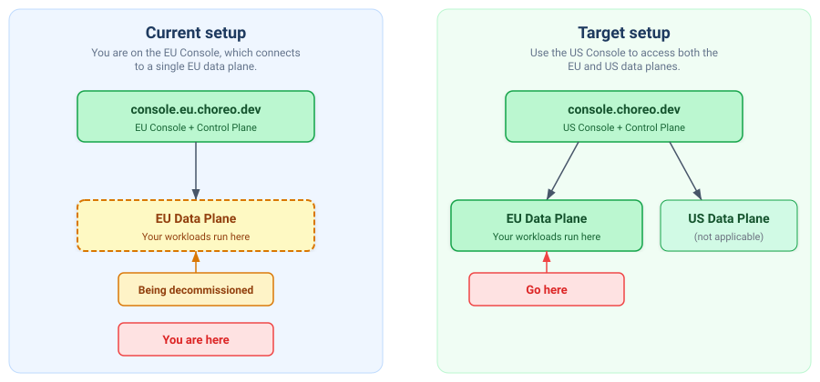
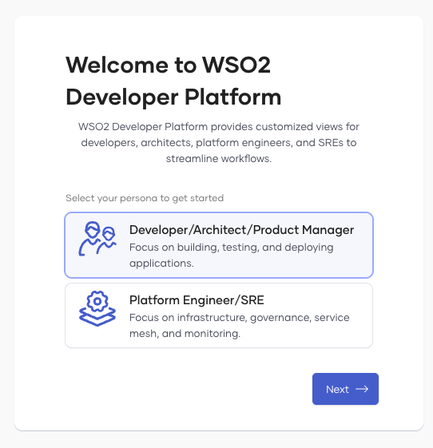
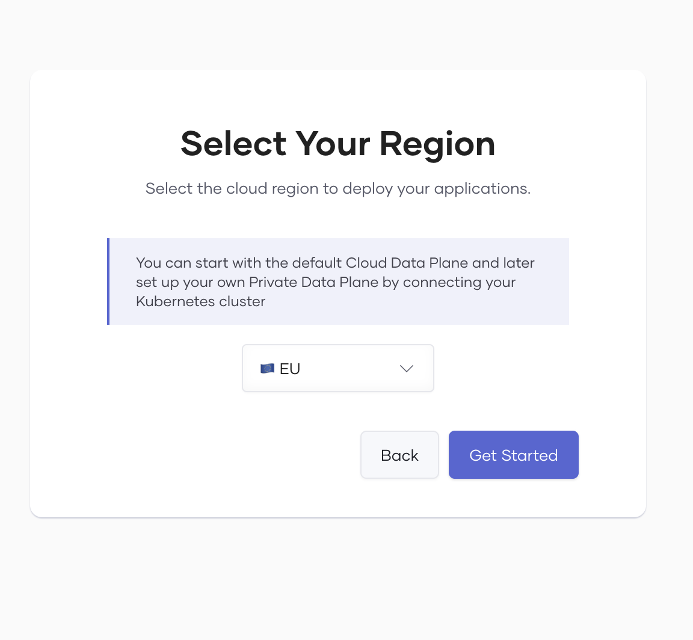

---
search:
  exclude: true
robots: noindex, nofollow
---

# Set Up Your Components on the {{ product_name }} US Console

WSO2 is discontinuing the **EU Console** (`console.eu.choreo.dev`) on **December 15, 2026**. On that date, the cloud data plane managed by the EU Console will be decommissioned, and applications running on it will no longer be accessible. You'll still be able to sign in to the EU Console and create components, but you won't be able to build or deploy them on its cloud data plane. This does not affect private data planes.

If you use the cloud data plane on the EU Console, you need to recreate your components in a new organization on the **US Console** (`console.choreo.dev`) before December 15, 2026. When you create the new organization, select the **EU** region. This allows you to run your workloads on a different EU data plane managed through the US Console.

!!! info "This is not an automated migration"
    Your existing organization, components, configurations, and credentials are **not** copied over. You must create a new organization, recreate each of your components, connect your source repositories, build, and deploy them from scratch on the US Console.

## What is changing?

The EU Console has its own control plane and a single EU data plane. The US Console also offers an EU data plane, but this is a separate data plane managed by the US control plane. Your workloads continue to run in the EU, but the console you use and the underlying infrastructure change.

| Aspect                    | Current (EU Region)                                                  | New (US Region with EU Data Plane)                                             |
|---------------------------|----------------------------------------------------------------------|--------------------------------------------------------------------------------|
| **Console**               | `console.eu.choreo.dev`                                              | `console.choreo.dev`                                                           |
| **Control plane**         | EU                                                                   | US                                                                             |
| **Data plane**            | EU data plane (managed by EU control plane)                          | EU data plane (managed by US control plane)                                    |
| **Default web app URL**   | `https://{id}.e1-eu-west-cdp.choreoapps.dev`                         | `https://{id}.e1-eu-north-azure.choreoapps.dev`                                |
| **API endpoint pattern**  | `https://{id}-{env}.e1-eu-west-cdp.choreoapis.dev/{path}`            | `https://{id}-{env}.e1-eu-north-azure.choreoapis.dev/{path}`                   |

!!! note "Data residency"
    After you set up on the US Console, your application workloads continue to run in the EU on the EU data plane. Control data such as component metadata and user details is stored in the US, where the control plane is hosted.

## Prerequisites

- An email address or a GitHub, Google, or Microsoft account to sign up for {{ product_name }}.
- Access to your component source code repositories.
- A list of everything you need to recreate from your EU Console organization: components, environments, CD pipelines, configuration groups, configurations and secrets, custom domains.
- The values of your configurations and secrets, from your own records.

## Step 1: Create a new organization on the US Region console

1. Go directly to the [US Console signup page](https://console.choreo.dev/signup). Sign up using your email address, or sign in with your GitHub, Google, or Microsoft account.
2. Enter a unique organization name.
3. Read and accept the privacy policy and terms of use.
4. Click **Create**.
5. Select your persona and click **Next**. The default option works for most users.

    {.cInlineImage-threeQuarter}

6. On the **Select Your Region** screen, select **EU** from the region dropdown. This determines which data plane your organization uses by default.

    !!! warning "Critical: choose the correct region"
        Free-tier organizations are locked to the data plane region selected at onboarding. You cannot change it later without a paid subscription. If you select the wrong region, you must create a new organization.

    {.cInlineImage-threeQuarter}

7. Click **Get Started**.

For more details on data planes and region selection, see [Data Planes](https://wso2.com/choreo/docs/choreo-concepts/data-planes/).

## Step 2: Set up your project and environments

Before recreating your components, set up the project structure and environments to match your EU Console organization:

1. **Create a project**: On the organization home page, click **+ Create Project** and enter a name and description.
2. **Review environments**: Your new organization comes with default Development and Production environments on the EU data plane. If you have additional environments on the EU Console, create them under **DevOps > Environments**. See [Manage Environments](https://wso2.com/choreo/docs/devops-and-ci-cd/manage-environments/).
3. **Configure CD pipelines**: If you had custom CD pipelines or environment promotion workflows, set those up under **DevOps > CD Pipelines**. See [Manage CD Pipelines](https://wso2.com/choreo/docs/devops-and-ci-cd/manage-continuous-deployment-pipelines/).
4. **Set up configuration groups**: If you used configuration groups to share settings across components, recreate them under **DevOps > Configuration Groups**. See [Manage Configuration Groups](https://wso2.com/choreo/docs/devops-and-ci-cd/manage-configuration-groups/).

## Step 3: Recreate your components

Recreate each of your components in the new organization and connect them to your source code repositories. This is the same process you followed when you originally set up your components.

The example below shows how to set up a web application component. Follow the same approach for any other component types (services, API proxies, integrations, etc.) you need to recreate.

### Example: Create a web application component

1. On the project home page, click **Web Application** under **Create a Component**.
2. Connect your source code repository (GitHub, Bitbucket, or GitLab).
3. Configure the build settings for your web application (build preset, project directory, port, etc.).

For detailed steps, follow this [guide](https://wso2.com/choreo/docs/quick-start-guides/deploy-your-first-static-web-application/).

## Step 4: Recreate configurations, secrets, and credentials

Set these up before you deploy, so your components start with the configuration they expect.

- If you had configurations or secrets (environment variables, API keys, and so on) in your old organization, set them up again in the new one. See [Manage Configurations and Secrets](https://wso2.com/choreo/docs/devops-and-ci-cd/manage-configurations-and-secrets/).
- If you consume APIs via OAuth2, you get new consumer keys and secrets when you generate credentials for your applications in the new organization. Update any clients that use these credentials.
- If you had enterprise login or an external identity provider configured, set that up again too. See [Configure Enterprise Login](https://wso2.com/choreo/docs/administer/configure-enterprise-login/).

## Step 5: Update IP allowlists

If your components call backend services that restrict access by IP address, add the new egress IP range to those allowlists.

| Old egress IPs (EU Console)             | New egress IP range (US Console, EU data plane) |
|-----------------------------------------|-------------------------------------------------|
| `54.170.135.118`, `52.215.28.29`        | `20.166.183.112/28`                             |

For more details, see the [FAQ on egress IP ranges](https://wso2.com/choreo/docs/references/faq/#security-and-data-protection).

## Step 6: Build and deploy

1. Build each component.
2. Deploy to the **Development** environment and verify it works.
3. Promote to **Production** when ready.
4. Repeat for all components you need to recreate.

## Step 7: Update your URLs

Your new components will have different default URLs. Update any clients, bookmarks, or integrations that reference the old URLs.

- **Default web app URL**: Your new deployment will get a new URL under `choreoapps.dev`. When you promote to production, you can choose a short URL prefix (`https://{your-prefix}.choreoapps.dev`).
- **API endpoints**: If your components call APIs hosted on {{ product_name }}, the endpoint URLs will follow the `e1-eu-north-azure.choreoapis.dev` pattern. Update any hardcoded API URLs in your application.

If you use a custom domain, see [Step 8](#step-8-reconfigure-custom-domains).

## Step 8: Reconfigure custom domains

If you have a custom domain configured for your EU Console organization, set it up again in your new organization on the US Console. See [Configure a Custom Domain for Your Organization](https://wso2.com/choreo/docs/administer/configure-a-custom-domain-for-your-organization/) for instructions.

!!! tip
    If you need help planning your DNS cutover or traffic transition, contact our support team.

## Step 9: Verify and switch over

1. Confirm that all your components are running correctly on the new organization.
2. Update DNS records or client configurations to point to the new deployment.
3. Verify that end-user traffic is flowing through the EU data plane on the US Console.
4. Remove the old EU Console egress IPs from your backend allowlists.
5. Once everything is working, you no longer need the old organization on the EU Console.

## Deadline

Customers must complete this process before **December 15, 2026**. After this date, the EU Region cloud data plane will be decommissioned, and applications running on it will no longer be accessible.

For assistance, contact **support@wso2.com**.
